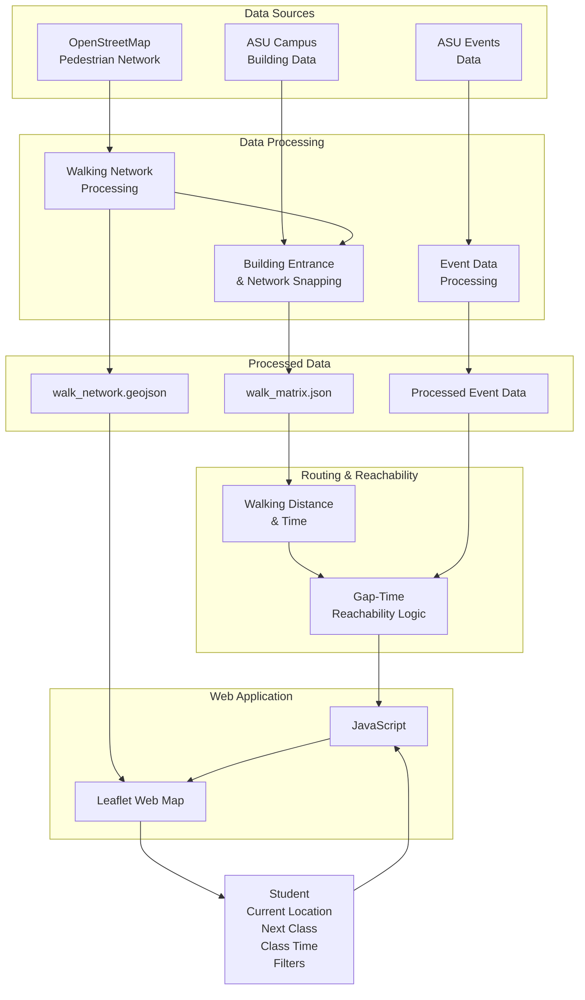

# ASU Gap Time Map — System Architecture

The ASU Gap Time Map combines campus building, event, and pedestrian network data to identify activities that students can reach during gaps between classes while still allowing enough time to walk to their next class.

## Architecture Components

- **OpenStreetMap:** Provides the pedestrian network used for campus walking analysis.
- **ASU building data:** Provides campus building locations used as origins and destinations.
- **ASU Events data:** Provides campus events that students may visit during available gap time.
- **Walking network processing:** Prepares the pedestrian network for routing.
- **Building/network snapping:** Connects campus buildings or entrances to the walking network.
- **`walk_network.geojson`:** Stores walking-network geometry for map visualization.
- **`walk_matrix.json`:** Stores building-to-building walking distances.
- **Walking-time analysis:** Converts network distance into estimated walking time.
- **Reachability logic:** Determines whether a student can visit an event and still reach the next class on time.
- **Leaflet:** Displays buildings, events, walking information, and results on the interactive web map.