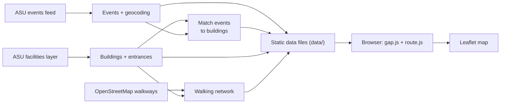

# ASU Gap Map: System Architecture

Everything heavy (geocoding, matching events to buildings, walking times) is done ahead of time by Python scripts and saved as static files. The web page only loads those files and does the "can I make it?" check in the browser, so there is no backend.



Scripts: Events + geocoding = `test_WebGIS.py`; Buildings + entrances = `buildings.py`, `entrances.py`; Walking network = `network.py`; Match events = `match_events.py`.

## How the pieces fit

**1. Data pipeline (Python, `pipeline/` and `test_WebGIS.py`)**

| Step | Script | Reads | Writes |
|---|---|---|---|
| Events | `test_WebGIS.py` | ASU events feed, Nominatim | `asu_events_output/*`, `data/events_data.js` |
| Buildings | `pipeline/buildings.py` | ASU Facilities layer | `data/buildings.geojson` (261 Tempe buildings, keyed by `building_id`) |
| Entrances | `pipeline/entrances.py` | `buildings.geojson`, OSM | `data/building_entrances.json` |
| Walking network | `pipeline/network.py` | OSM walkways, buildings, entrances | `data/walk_matrix.json`, `walk_network.geojson`, `building_snaps.json` |
| Event to building | `pipeline/match_events.py` | `asu_events.csv`, `buildings.geojson` | `data/event_buildings.csv` |

Order matters: `entrances.py` before `network.py`, and `test_WebGIS.py` before `match_events.py`. The events steps need a rerun about once a week (the feed only lists upcoming events). The building and network steps only need a rerun if the campus data changes.

**2. Walking times.** `network.py` builds a graph from OSM walkways, snaps each building onto it (from its entrance when there is one), and runs Dijkstra from every building. `walk_matrix.json` is `{from_id: {to_id: seconds}}` for all 261 x 261 pairs.

**3. The check in the browser (`web/gap.js`).** For each event on the chosen day:

```
free from -> walk there -> be there (or join in progress) -> stay -> walk to class -> buffer <= class starts
```

- *Free from* is the lower bound: events that end before you can arrive are dropped.
- *Class starts* is the upper bound: you must leave in time for the walk and the buffer.
- Event end times are used, so events already in progress count.

**4. Routes (`web/route.js`).** When an event is picked, the browser runs a shortest path on `walk_network.geojson` and draws A to event to B on the real walkways. The times match `walk_matrix.json` within about 0.1 min.

**5. Map (Leaflet).** One marker per building with an event count, plus draggable A (where I am) and B (next class) pins that snap to the nearest building.

## Design choices

- **Static files, no server logic.** Easy to host, but `fetch` needs a local server (`python3 -m http.server`) and the data is only as fresh as the last pipeline run.
- **`building_id` is the key everywhere.** It is the ASU code students see on their schedule (`MU`, `COOR`), and it joins events, buildings and walking times.
- **Walking times are precomputed.** The browser never searches the whole network just to rank events; it looks up one number per pair. The route search only runs for the one event you pick.

## Known limits

- Only Tempe campus buildings are in the data, so the gap page only shows events that match one of them. 256 of 500 event times have no `building_id` in the latest run: about 105 are online, about 145 are on other campuses or off campus (Downtown Phoenix, Polytechnic, West Valley, Mesa, California, ...), and about 6 are on the Tempe campus but could not be matched.
- 14 event-to-building matches are flagged for a manual check (`review` column in `event_buildings.csv`).
- Entrances are estimated for most buildings (only a few have a real OSM door), so walking times lean a bit short.
- No stairs, elevation or crossing waits.
- Single next class only; no saved multi-course schedule yet.
